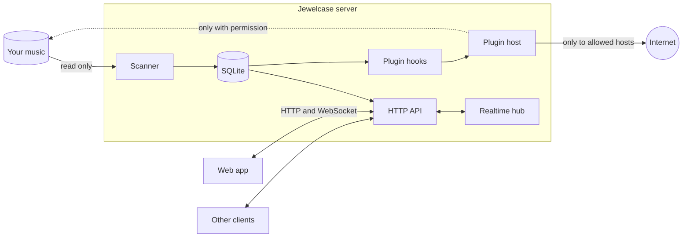

# Architecture

How Jewelcase fits together: the pieces, how data moves between them, and where plugins plug
in. The full designs are in [`design/`](../design/), and the reasons behind the big choices are
in [`adr/`](../adr/).

## The big picture

Jewelcase is one server process with a SQLite database and no other services. In a release,
the server also serves the web app's files; in development, the web app runs on its own
development server.

- **The scanner** is the only thing that puts music into the database.
- **The HTTP API** is the only way in. The web app uses the same public API any other client
  would, described in [`api/openapi.yaml`](../api/openapi.yaml).
- **Plugins** run inside the server, sandboxed, and reach only what an admin approved.

## The pieces

| Piece | Where | What it does |
|---|---|---|
| Server | [`crates/server`](../crates/server/) | Starts everything. Serves the HTTP API and realtime connections, handles accounts and sessions, owns the database, and runs plugin hooks. Built on Tokio and Axum. |
| Scanner | [`crates/scanner`](../crates/scanner/) | Walks the music folders, reads tags and files beside the music (cover art, lyrics), watches for changes, and analyzes audio for loudness and waveforms in the background. |
| Core | [`crates/core`](../crates/core/) | Rules that must give the same answer everywhere, such as search matching and sort order. No I/O, so the same code can later run in the browser and on Android. |
| ffmpeg | [`crates/ffmpeg`](../crates/ffmpeg/) | Runs ffmpeg as a separate process to decode audio and images, so a broken file can't crash the server. |
| Plugin host | [`crates/plugins`](../crates/plugins/) | Runs plugins in Wasmtime, checks their manifests, and enforces their permissions and limits. |
| Web app | [`web`](../web/) | Svelte 5 and SvelteKit, built as static files with no server of its own. |

## How data moves

**Scanning.** Each library has one scanner with one queue of folders to scan. The file watcher,
the daily schedule, and startup all just add folders to that queue, so overlapping triggers
never do the same work twice. A file whose path, size, and modified time haven't changed is
skipped without being opened, which keeps rescans of a large library cheap. Missing files are
marked missing rather than deleted, so their history stays. Loudness and waveform analysis run
later, on a separate queue, so they never slow down indexing. See
[`design/scanning.md`](../design/scanning.md).

**The change feed.** Every change the scanner makes to a library is also written to that
library's change feed, in the same transaction. Plugin hooks read the feed from a saved
position, so a plugin never misses a change, even across restarts. Clients will sync from the
same feed for offline use. See [`design/database.md`](../design/database.md).

**Browsing and search.** API requests read from SQLite. Search runs against
an index each library keeps in memory, using the matching rules in `crates/core`.

**Playback.** Audio is streamed straight from the original file, with range requests for
seeking. When a client reports a finished play (`POST /me/plays`), it's saved along with the
event plugins receive, so the two can't disagree.

**Realtime.** Each signed-in device holds one WebSocket. The server keeps each account's player
state, decides which device is playing, and routes remote-control commands to it.

## Rules the code keeps

The main ones, from the core principles in
[`requirements/general.md` §3](../requirements/general.md#3-core-principles). A change that
breaks a core principle won't be accepted.

- **The music is read-only to the core.** All of its state lives in the data directory:
  `state/` for what must be backed up, `cache/` for what can be rebuilt.
- **The scanner is the only way music gets into the database.** Plugins that change the library
  write files, and the scanner picks them up like any other change.
- **Libraries are walls.** Every query on library content takes a `Scope`, the account and a
  library it can reach, checked once by the auth layer. Anything outside it answers `404`.
  Leaking across libraries is the most serious kind of bug.
- **Responses carry only what the client needs.** API types are written for the client, never
  database rows, and never include file paths.
- **No built-in limits on library size or users.** The hardware is the only limit, so code must
  stay fast as the library grows.

## Plugins

A plugin is one WebAssembly component with its manifest packed inside. The
[plugin guide](../plugins/README.md) covers writing one; this is how the host runs it.

**The contract** is [`crates/plugins/wit/plugin.wit`](../crates/plugins/wit/plugin.wit). A
plugin exports one function, `handle(event)`, and imports what it needs from the host:

| Import | What it gives |
|---|---|
| `library` | Reading tracks, albums, and artists, in pages |
| `files` | Reading files in the library, and adding or changing them |
| `http` | Requests to the hosts the manifest names |
| `state` | Storage that lasts between runs |
| `settings` | The admin's settings, and each user's when they connect the plugin |
| `host` | Logging, and which permissions were granted |

**Events** start each run: tracks changed, albums or artists changed, a scan finished, a
schedule, a play finished or started, a search, a user asking for their searches to be
forgotten, settings being checked, or an admin pressing **Run now**.

**Permissions.** The manifest asks for each permission and event with a reason the admin sees.
An admin installs the plugin, approves what it asks for, and turns it on per library. Every
import checks its permission in the host, and the plugin's library is bound into its sandbox,
so it can't name another one.

**Running.** Each plugin is compiled once when it's installed, and each run starts a fresh copy
in microseconds. Each run has limits on CPU time, wall-clock time, memory, and request sizes. A
crash or timeout ends that run and nothing else. A plugin that keeps failing is
retried with growing waits, and is turned off for a library after 72 hours of failures.

Details: [`design/plugins.md`](../design/plugins.md) for how plugins run,
[`design/imports.md`](../design/imports.md), [`design/hooks.md`](../design/hooks.md), and
[`design/exports.md`](../design/exports.md) for what they can call and be called with.

## Repository layout

| Folder | What's in it |
|---|---|
| [`crates/`](../crates/) | The Rust workspace: the pieces above |
| [`web/`](../web/) | The web app, and a mock API for working on it without the server |
| [`plugins/`](../plugins/) | Example plugins and the plugin guide |
| [`tools/plugin-pack/`](../tools/plugin-pack/) | Packs a plugin's manifest into its WebAssembly file |
| [`api/`](../api/) | The OpenAPI description of the HTTP API |
| [`requirements/`](../requirements/) | What Jewelcase must do |
| [`design/`](../design/) | How each part does it |
| [`adr/`](../adr/) | The big decisions, and when they were made |
| [`PLAN.md`](../PLAN.md) | What's built, and the order of what's next |
